# ZMK Battery Typer

[](https://github.com/eintim/zmk-behavior-battery-typer/actions/workflows/build.yml)
[](LICENSE)

Check the battery level of your wireless ZMK keyboard with one key. This [ZMK firmware](https://zmk.dev) module adds the `&bat_print` behavior. Press the key and the keyboard types its battery percentage into the focused text field. On a split keyboard such as a Corne, Sofle, Lily58 or Kyria, it types the level of each half.



## Why

Most wireless ZMK keyboards have no display. Many operating systems show one battery level for a split keyboard, or none at all. This behavior works without a display or host software. Open any text field and press the key.

## Installation

### 1. Add the module

In your zmk-config repo, edit `config/west.yml`:

```yaml
manifest:
  remotes:
    - name: zmkfirmware
      url-base: https://github.com/zmkfirmware
    - name: eintim
      url-base: https://github.com/eintim

  projects:
    - name: zmk
      remote: zmkfirmware
      revision: main
      import: app/west.yml

    - name: zmk-behavior-battery-typer
      remote: eintim
      revision: v1.0

  self:
    path: config
```

The `v1.0` tag points to the latest `v1.0.x` release. To follow development, use `main` instead.

### 2. Add the behavior to your keymap

At the top of your keymap file, add:

```dts
#include <behaviors/bat_print.dtsi>
```

Then bind it to a key like any other behavior:

```dts
&bat_print
```

The behavior needs battery reporting (`CONFIG_ZMK_BATTERY_REPORTING`). BLE keyboards have it on by default.

The behavior ignores held modifiers while it types, so holding Shift does not turn `87` into `*&`.

## Split keyboards

To type the levels of the peripheral halves too, add this line to your config:

`CONFIG_ZMK_SPLIT_BLE_CENTRAL_BATTERY_LEVEL_FETCHING=y`

Without it, the behavior types only the central half. With more than one peripheral, it types each level in order, separated by spaces. A disconnected peripheral shows as `-`, for example `87 -`.

## ZMK Studio

In [ZMK Studio](https://zmk.dev/docs/features/studio), the behavior appears as **Battery Print**. Studio builds keep it in the firmware when your keymap includes `behaviors/bat_print.dtsi`, even if no key uses it. This lets you assign it to a key from Studio. To leave it out of the firmware, define `ZMK_BEHAVIORS_OMIT_BAT_PRINT` before the include.

## Optional settings

### Bind to a combo

```dts
/ {
  combos {
    compatible = "zmk,combos";

    batt_combo {
      timeout-ms = <40>;
      key-positions = <12 13>;  // adjust for your layout
      bindings = <&bat_print>;
    };
  };
};
```

### Adjust typing speed

The behavior sends keys through ZMK's behavior queue, the same way macros do. If your host drops characters, slow it down:

```dts
&bat_print {
  tap-ms = <30>;   // how long each key is held (default 30)
  wait-ms = <15>;  // pause after each key (default 15)
};
```
